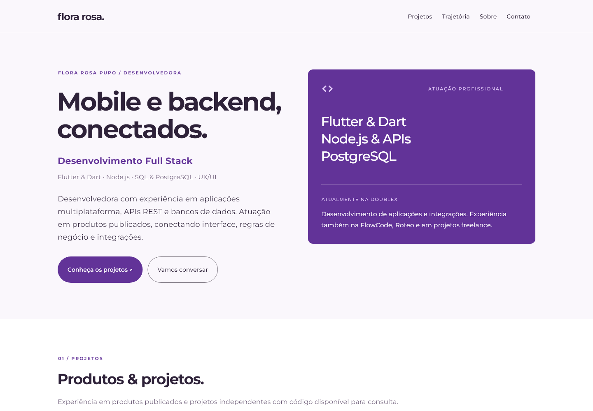
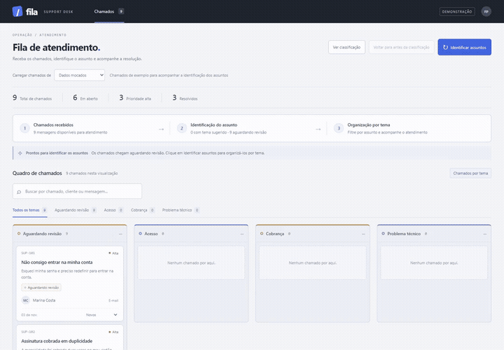

# Flora Rosa Pupo · Portfólio

Portfólio profissional de uma desenvolvedora Full Stack, com experiência em Flutter, backend e integrações. Reúne minha trajetória, trabalhos profissionais, projetos autorais de IA e machine learning e demonstrações dos aplicativos.

**[Acessar o portfólio](https://flora-rosa.web.app)** · [LinkedIn](https://www.linkedin.com/in/florarosa/) · [GitHub](https://github.com/FloraRosaPupo)



## Projetos em destaque

| Projeto | O que faz | Tecnologias principais |
| --- | --- | --- |
| [RepoMentor](https://github.com/FloraRosaPupo/repomentor) | Explora repositórios públicos, issues e caminhos para contribuir com apoio do Gemma. | React, JavaScript, Vite, Python, FastAPI, HTTPX, Pydantic, GitHub API, Gemma 4, Google AI Studio e integração opcional com Vertex AI. |
| [Triagem](https://github.com/FloraRosaPupo/ticket-triage-ml) | Sugere assuntos para chamados de suporte e organiza a revisão em um painel Kanban. | React, JavaScript, Parcel, Python, scikit-learn, TF-IDF, regressão logística, NumPy, SciPy, Joblib, RandomAPI, MyMemory e Playwright. |
| [Avalia](https://github.com/FloraRosaPupo/projeto_Avalia) | Projeto de aprendizado para correção de provas com IA, gestão de turmas e acompanhamento de resultados. | Flutter, Dart, Cubit/BLoC, Supabase, Google Gemini, Equatable, Lottie, Flutter Test, bloc_test e Mocktail. |
| [Bebeu?](https://github.com/FloraRosaPupo/controle_agua) | Acompanha a hidratação, com histórico, lembretes e widget na tela inicial. | Flutter, Dart, Provider/BLoC, GoRouter, SQLite, Home Widget, notificações locais, Secure Storage, Node.js, TypeScript, Express, Prisma, PostgreSQL e JWT. |

Os cartões no site apresentam as listas ampliadas de tecnologias, incluindo bibliotecas, integrações e ferramentas de testes e build de cada projeto.

### Demonstrações

**RepoMentor — consulta, seleção e busca de issues públicas**


**Triagem — classificação de chamados fictícios, detalhes e relatório**



No site, as prévias usam vídeos MP4 leves, silenciosos e com controles de pausa. Os [vídeos do Avalia](web/previews/avalia.mp4) e do [Bebeu?](web/previews/bebeu.mp4) continuam disponíveis. Movimento reduzido utiliza imagens estáticas.

As gravações mostram interfaces reais. O Triagem usa chamados fictícios e uma base pequena e sintética, sem comprovar desempenho em produção. A prévia do RepoMentor consulta issues públicas e não executa inferência do Gemma. Avalia e Bebeu utilizam dados demonstrativos. Veja a [origem das novas demonstrações](docs/projetos-recentes.md) e o [registro das capturas anteriores](docs/portfolio-conteudo.md).

## O que o portfólio oferece

- Um único carrossel automático de **Projetos pessoais**, feito com `PageView`, reúne **RepoMentor, Triagem, Avalia e Bebeu?**. Mostra um projeto por vez, com demonstração à esquerda e descrição e tecnologias à direita no desktop; no celular, os elementos ficam empilhados.
- No desktop, as abas acompanham o projeto selecionado; no celular, quatro indicadores na base permitem ir direto a cada projeto. O `PageView` também aceita deslize.
- Troca a cada **12 segundos** enquanto visível, pausa ao passar o mouse e botão de pausa/retomada.
- Experiência profissional e voluntária com Easy Comlink, IndicaZ Profissionais, Roteo e ASSID, com links públicos dos produtos.
- Interface responsiva em **português, inglês e espanhol**, temas claro e escuro e respeito à preferência por movimento reduzido.
- Trajetória, formação, competências e uma seção sobre meu processo de desenvolvimento com IA.
- Contato por WhatsApp, e-mail, LinkedIn e GitHub, além do currículo em português.
- Carregamento com feedback e uma alternativa textual com contatos se a aplicação falhar.

Idioma e tema ficam salvos no navegador. O currículo PDF permanece em português; as traduções da interface não representam uma declaração de fluência.

## Tecnologias deste repositório

| Área | Tecnologias |
| --- | --- |
| Aplicação | Flutter, Dart, Material Design, `url_launcher` e `flutter_localizations`. |
| Interface web | HTML, CSS, JavaScript, vídeo HTML5 e armazenamento local do navegador. |
| Identidade visual | Fonte Montserrat, Material Icons e paleta roxa com tema claro/escuro. |
| Qualidade | Flutter Test, Flutter Lints, análise estática Dart e testes de inicialização com Node.js. |
| Publicação | Firebase Hosting, GitHub Actions e scripts Python para configuração de hospedagem. |

As versões e dependências diretas estão no [pubspec.yaml](pubspec.yaml). O cliente não precisa inicializar Firebase Auth ou Firebase Core para funcionar.

## Executar localmente

Use **Flutter 3.41.1**, versão registrada na [CI](.github/workflows/ci.yml).

```sh
git clone https://github.com/FloraRosaPupo/Portifolio.git
cd Portifolio
flutter pub get
flutter run -d chrome
```

## Validar e compilar

```sh
flutter analyze --no-fatal-infos --no-fatal-warnings
flutter test
node --test test/bootstrap_test.cjs
flutter build web
```

Os testes cobrem navegação, links, idiomas, temas, rotação automática, pausa, movimento reduzido e layouts de 320, 430, 768 e 1440 pixels com texto ampliado. O build web é gerado em `build/web`.

Para gerar capturas desktop e mobile:

```sh
flutter test test/portfolio_capture_test.dart --dart-define=CAPTURE_PORTFOLIO=true
```

As imagens ficam em `captures/`. A reprodução das gravações dos projetos está documentada em [docs/projetos-recentes.md](docs/projetos-recentes.md).

## Organização

```text
lib/features/portfolio/
  data/           Conteúdo e traduções
  presentation/   Página, carrossel, preferências e prévias
assets/projects/  Imagens estáticas dos projetos
web/previews/     Vídeos e GIFs demonstrativos
test/             Testes de interface e inicialização
scripts/          Captura, conversão e configuração de hospedagem
docs/             Decisões, evidências e documentação
```

Para atualizar o currículo, substitua `web/Curriculo_Flora_Rosa_Pupo.pdf`. Para alterar os projetos e suas tecnologias, edite `portfolio_page.dart`; os textos em inglês e espanhol ficam em `translations.dart`.

## Publicação

Pull requests do próprio repositório passam pelas verificações e geram uma prévia no Firebase Hosting. Atualizações na `main` publicam o site original e o endereço profissional **[flora-rosa.web.app](https://flora-rosa.web.app)**. As credenciais de publicação ficam nos secrets do GitHub Actions.

O APK em `apks/app-release.apk` é histórico; os workflows atuais não o recompilam.

## Contribuições e licença

Consulte o [guia de contribuição](CONTRIBUTING.md). Mantenha credenciais e arquivos gerados fora do Git e inclua testes para mudanças de comportamento.

Este repositório não define uma licença de distribuição. As atribuições e os direitos dos materiais de terceiros permanecem preservados.
