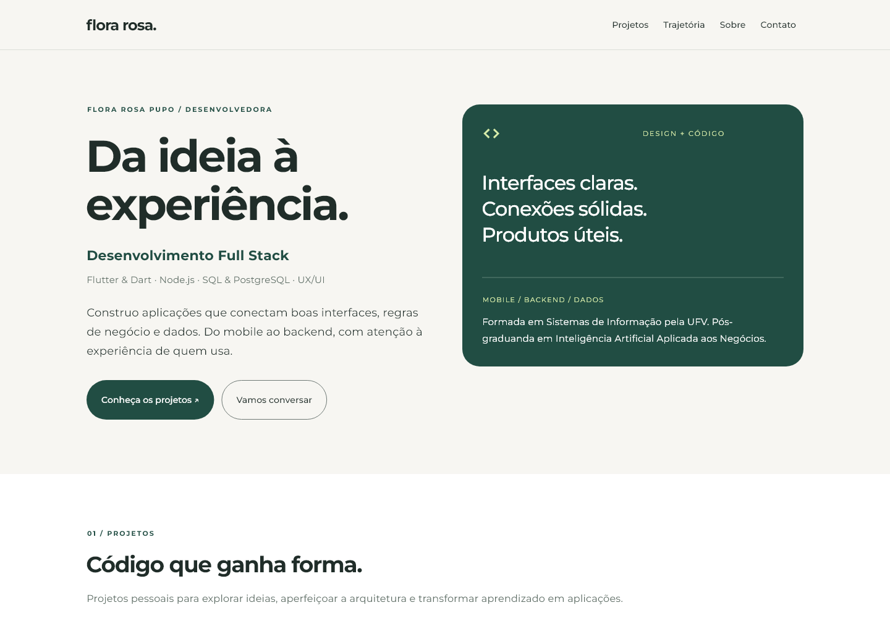

# Portfólio de Flora Rosa

## Descrição

Portfólio desenvolvido em Flutter para apresentar trajetória, experiências, projetos e canais de contato de Flora Rosa. A versão web utiliza Firebase Hosting.

## Stack e bibliotecas

Flutter/Dart, url_launcher e Firebase Hosting. A interface não depende de inicialização de serviços externos.

Dependências e versões declaradas: [pubspec.yaml](pubspec.yaml).

## Funcionalidades

- Página responsiva com navegação por seções.
- Projetos Avalia e Bebeu? com capturas reais de execução local.
- Links de aplicativos publicados na Google Play.
- Trajetória profissional, formação e competências.
- Contato por e-mail, LinkedIn e GitHub.

## Licença

Não há uma licença de distribuição definida para este repositório. Nenhuma licença MIT, Apache ou equivalente é concedida por este README. As atribuições e os direitos dos materiais de terceiros permanecem preservados.

## Validação e limites

Renderização da apresentação, compilação web e preview Firebase. O APK histórico não é recompilado por esta pipeline.

## Executar
Use a versão de Flutter registrada em `.github/workflows/ci.yml`.
```sh
git clone https://github.com/FloraRosaPupo/Portifolio.git
cd Portifolio
flutter pub get
flutter run
```

## Verificações
```sh
flutter analyze --no-fatal-infos --no-fatal-warnings
flutter test
```
A CI verifica erros de análise e os testes. Avisos e sugestões continuam visíveis no relatório do analisador. Testes locais não substituem a validação no dispositivo e dos serviços externos.

## Contribuir
Abra uma branch por alteração, descreva o comportamento esperado e inclua testes para regras ou regressões. Mantenha credenciais e arquivos gerados fora do Git.

## Organização e manutenção

`lib/features/portfolio` reúne conteúdo e apresentação. As páginas antigas foram substituídas por uma página com seções responsivas. A inicialização Firebase e as dependências sem uso foram removidas; Firebase Hosting continua hospedando a versão web.

Veja [a revisão de desenvolvimento](docs/REVISAO.md) para decisões, testes e limites, e [o guia de contribuição](CONTRIBUTING.md) para o fluxo de manutenção.

## Publicação web e APK

Os workflows Firebase compilam Flutter web. O APK existente continua em `apks/app-release.apk` no GitHub; `/app-release.apk` redireciona para esse arquivo, pois o plano Spark do Firebase Hosting não aceita executáveis. O workflow não recompila o APK. O cliente não utiliza Firebase Auth nem Firebase Core. O preview depende da conta de serviço já configurada no repositório.

## Visual e conteúdo



Experiência e formação atualizadas a partir do currículo da autora. [Origem do conteúdo e das capturas](docs/portfolio-conteudo.md).

As capturas dos aplicativos são geradas localmente; o Bebeu? utiliza dados demonstrativos. Não representam uma sessão conectada a uma conta real.

Para gerar capturas do próprio portfólio:

```sh
flutter test test/portfolio_capture_test.dart --dart-define=CAPTURE_PORTFOLIO=true
```

As imagens ficam em `captures/`. Os testes regulares verificam larguras de 320, 430, 768 e 1440 pixels, texto ampliado, navegação e abertura de links.
