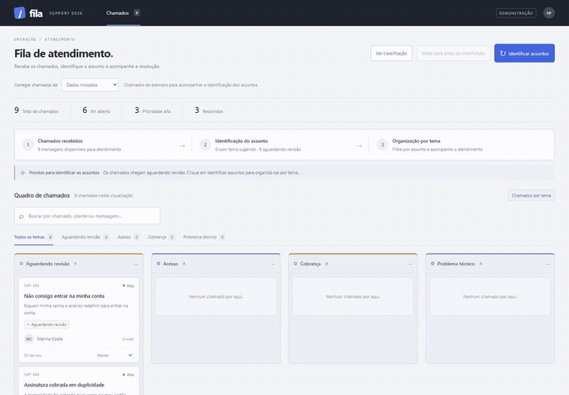

# Flora Rosa Pupo · Portfólio

Portfólio profissional de Flora Rosa Pupo, engenheira de IA e desenvolvedora Full Stack. Reúne projetos de IA aplicada com RAG, MCP e modelos de linguagem, experiência em Flutter, backend e integrações, formação e demonstrações das aplicações.

**[Acessar o portfólio](https://flora-rosa.web.app)** · [LinkedIn](https://www.linkedin.com/in/florarosa/) · [GitHub](https://github.com/FloraRosaPupo)

## Projetos em destaque

| Projeto | O que faz | Tecnologias principais |
| --- | --- | --- |
| [Chat com contratos](https://github.com/FloraRosaPupo/chat-com-contratos) | Consulta contratos com citações de cláusula e página, compara respostas com e sem RAG e inclui avaliações automatizadas na CI. | Flutter, Python, FastAPI, ChromaDB, embeddings e Ollama. |
| [Assistente de pesquisa](https://github.com/FloraRosaPupo/assistente-pesquisa) | Consulta artigos científicos com RAG e fontes citadas; usa servidores MCP para busca no arXiv, ingestão e recuperação de trechos. | Python, LangGraph, MCP, pgvector e Ollama. |
| [RepoMentor: código](https://github.com/FloraRosaPupo/repomentor) · [app na Vercel](https://repomentor-alpha.vercel.app) | Explora repositórios públicos, issues e caminhos para contribuir com apoio do Gemma. | React, JavaScript, Vite, Python, FastAPI, HTTPX, Pydantic, GitHub API, Gemma 4, Google AI Studio e integração opcional com Vertex AI. |
| [Triagem](https://github.com/FloraRosaPupo/ticket-triage-ml) | Sugere assuntos para chamados de suporte e organiza a revisão em um painel Kanban. | React, JavaScript, Parcel, Python, scikit-learn, TF-IDF, regressão logística, NumPy, SciPy, Joblib, RandomAPI, MyMemory e Playwright. |
| [Avalia](https://github.com/FloraRosaPupo/projeto_Avalia) | Projeto de aprendizado para correção de provas com IA, gestão de turmas e acompanhamento de resultados. | Flutter, Dart, Cubit/BLoC, Supabase, Google Gemini, Equatable, Lottie, Flutter Test, bloc_test e Mocktail. |
| [Bebeu?](https://github.com/FloraRosaPupo/controle_agua) | Acompanha a hidratação, com histórico, lembretes e widget na tela inicial. | Flutter, Dart, Provider/BLoC, GoRouter, SQLite, Home Widget, notificações locais, Secure Storage, Node.js, TypeScript, Express, Prisma, PostgreSQL e JWT. |

A página principal destaca Engenharia de IA. Os seis projetos compartilham o mesmo carrossel de **Projetos pessoais**, com abas, descrição, tecnologias, código e vídeo: RepoMentor, Triagem, Avalia, Bebeu?, Chat com contratos e Assistente de pesquisa. Na rota **/ia**, os dois últimos também entram na sequência do carrossel Meu trabalho com IA, após os três estudos existentes.

### Demonstrações

- [Chat com contratos - MP4, aproximadamente 12 segundos](web/previews/chat-com-contratos.mp4): comparação com/sem RAG e navegação por recuperação, prompts e mapa de embeddings.
- [Assistente de pesquisa - MP4, 18 segundos](web/previews/assistente-pesquisa.mp4): pergunta, resposta em streaming e consulta às fontes.

Essas duas gravações usam as interfaces reais com dados e respostas simulados, identificados no vídeo. Não executam inferência de modelos nem medem desempenho de recuperação. Os arquivos somam aproximadamente 231 KB; as imagens estáticas estão em `assets/projects/`. Os scripts `capture-ai-projects.cjs`, `capture-research-api.py` e `encode-ai-projects.py` documentam o processo, descrito em [docs/portfolio-conteudo.md](docs/portfolio-conteudo.md).

**RepoMentor — consulta, seleção e busca de issues públicas**


**Triagem — classificação de chamados fictícios, detalhes e relatório**



No site, as prévias usam vídeos MP4 leves, silenciosos, em loop e com controles de pausa. São carregados quando entram na área visível e pausam fora dela. Os [vídeos do Avalia](web/previews/avalia.mp4) e do [Bebeu?](web/previews/bebeu.mp4) continuam disponíveis. Movimento reduzido utiliza imagens estáticas.

As gravações mostram interfaces reais. O Triagem usa chamados fictícios e uma base pequena e sintética, sem comprovar desempenho em produção. A prévia do RepoMentor consulta issues públicas e não executa inferência do Gemma. Avalia e Bebeu utilizam dados demonstrativos. Veja a [origem das novas demonstrações](docs/projetos-recentes.md) e o [registro das capturas anteriores](docs/portfolio-conteudo.md).

## O que o portfólio oferece

- O carrossel automático de **Projetos pessoais**, feito com `PageView`, reúne **RepoMentor, Triagem, Avalia, Bebeu?, Chat com contratos e Assistente de pesquisa**. Mostra um projeto por vez, com demonstração à esquerda e descrição e tecnologias à direita no desktop; no celular, os elementos ficam empilhados.
- No desktop, as abas acompanham o projeto selecionado; no celular, seis indicadores na base permitem ir direto a cada projeto. O `PageView` também aceita deslize.
- Troca a cada **12 segundos** enquanto visível e pausa ao passar o mouse.
- Experiência profissional e voluntária com Easy Comlink, IndicaZ Profissionais, Roteo e ASSID, com links públicos dos produtos.
- Interface responsiva em **português, inglês e espanhol**, temas claro e escuro e respeito à preferência por movimento reduzido.
- Trajetória, pós-graduação concluída em Inteligência Artificial Aplicada aos Negócios pela UniBH, competências e processo de desenvolvimento com IA.
- Certificados **Claude in Action** e **Model Context Protocol: Advanced Topics**, da Anthropic, com acesso às credenciais pelo LinkedIn.
- Contato por WhatsApp, e-mail, LinkedIn e GitHub, além de currículo geral em português, formatado para ATS.
- Carregamento com feedback e uma alternativa textual com contatos se a aplicação falhar.

Idioma e tema ficam salvos no navegador. O currículo PDF permanece em português; as traduções da interface não representam uma declaração de fluência.

## Tecnologias deste repositório

| Área | Tecnologias |
| --- | --- |
| Aplicação | Flutter, Dart, Material Design, `url_launcher` e `flutter_localizations`. |
| Interface web | HTML, CSS, JavaScript, vídeo HTML5 e armazenamento local do navegador. |
| Identidade visual | Fonte Montserrat, Material Icons e paleta roxa com tema claro/escuro. |
| Qualidade | Flutter Test, Flutter Lints, análise estática Dart e testes de inicialização com Node.js. |
| Publicação | Firebase Hosting, GitHub Actions e scripts Python para configuração de hospedagem. |

As versões e dependências diretas estão no [pubspec.yaml](pubspec.yaml). O cliente não precisa inicializar Firebase Auth ou Firebase Core para funcionar.

## Executar localmente

Use **Flutter 3.41.1**, versão registrada na [CI](.github/workflows/ci.yml).

```sh
git clone https://github.com/FloraRosaPupo/Portifolio.git
cd Portifolio
flutter pub get
flutter run -d chrome
```

## Validar e compilar

```sh
flutter analyze --no-fatal-infos --no-fatal-warnings
flutter test
node --test test/bootstrap_test.cjs
flutter build web
```

Os testes cobrem navegação, links, idiomas, temas, rotação automática, pausa, movimento reduzido e layouts de 320, 430, 768 e 1440 pixels com texto ampliado. O build web é gerado em `build/web`.

Para gerar capturas desktop e mobile:

```sh
flutter test test/portfolio_capture_test.dart --dart-define=CAPTURE_PORTFOLIO=true
```

As imagens ficam em `captures/`. A reprodução das gravações dos projetos está documentada em [docs/projetos-recentes.md](docs/projetos-recentes.md).

## Organização

```text
lib/features/portfolio/
  data/           Conteúdo e traduções
  presentation/   Página, carrossel, preferências e prévias
lib/features/ai/
  data/           Estudos, casos documentados e traduções
  presentation/   Frente Flora × IA na rota /ia
assets/projects/  Imagens estáticas dos projetos
web/previews/     Vídeos e GIFs demonstrativos
test/             Testes de interface e inicialização
scripts/          Captura, conversão e configuração de hospedagem
docs/             Decisões, evidências e documentação
```

### Currículo para download

O botão **Baixar currículo (PT)** usa [web/Curriculo_Flora_Rosa_Pupo.pdf](web/Curriculo_Flora_Rosa_Pupo.pdf). É um currículo geral de Engenharia de IA e Desenvolvimento Full Stack, com duas páginas, uma coluna, texto selecionável e links clicáveis. Inclui experiência, competências, projetos, formação e certificados da Anthropic.

Para editar e regenerar o PDF, atualize `scripts/build-general-resume.py` e execute:

```sh
python scripts/build-general-resume.py
```

O script usa ReportLab e as fontes Arial instaladas em `C:/Windows/Fonts`; em outro sistema, ajuste os caminhos das fontes. Confira visualmente as duas páginas e a extração do texto antes de publicar. O deploy inclui o arquivo em `web/` no build Flutter.

Para alterar os projetos de IA e seus identificadores de mídia, edite `lib/features/portfolio/data/content.dart`. Os demais cards e a composição da página ficam em `portfolio_page.dart`; as traduções PT/EN/ES ficam em `translations.dart`.

## Publicação

O portfólio é publicado no **Firebase Hosting**. A demo do RepoMentor tem hospedagem própria na Vercel.

Pull requests do próprio repositório passam pelas verificações e geram uma prévia. Um push na `main` dispara [firebase-hosting-merge.yml](.github/workflows/firebase-hosting-merge.yml): instala o Flutter, executa análise estática, testes de interface e inicialização, gera `build/web` e publica os dois endereços:

- [flora-rosa.web.app](https://flora-rosa.web.app) - endereço profissional.
- [portifolio-d00ca.web.app](https://portifolio-d00ca.web.app) - endereço original.

As credenciais ficam nos secrets do GitHub Actions. Commit local não publica o site: é necessário enviar com `git push origin main` e conferir o resultado do workflow em [Actions](https://github.com/FloraRosaPupo/Portifolio/actions).

O APK em `apks/app-release.apk` é histórico; os workflows atuais não o recompilam.

## Contribuições e licença

Consulte o [guia de contribuição](CONTRIBUTING.md). Mantenha credenciais e arquivos gerados fora do Git e inclua testes para mudanças de comportamento.

Este repositório não define uma licença de distribuição. As atribuições e os direitos dos materiais de terceiros permanecem preservados.

## Flora × IA

A rota `/ia` abre uma frente autoral que complementa o portfólio principal, com tema escuro fixo e seletor PT/EN/ES. O tema escolhido no portfólio de desenvolvimento é preservado. O menu desktop e mobile inclui Flora × IA.

Dois carrosséis compactos apresentam: (1) Triagem, estudo acadêmico de VGG19, precificação imobiliária, Chat com contratos e Assistente de pesquisa; (2) cinco casos documentados: Amazon, Duolingo, See & Spray, Netflix e Walmart, acompanhados de propostas de adaptação. Cada item abre uma análise em janela de leitura. As propostas citam notícias com fonte, data e link e distinguem o fato publicado da solução exploratória. Manchetes originais são preservadas no idioma da fonte e identificadas como tal; análises e interface têm tradução editorial.

Triagem usa dados pequenos e sintéticos, sem comprovação em produção. O estudo acadêmico não tem treinamento ou resultados medidos. As cinco propostas são pesquisa assistida por IA para revisão da autora, sem alegações de participação nos casos noticiados. Fontes consultadas em 12/11/2026, listadas em `docs/casos-documentados.md`. A animação abstrata respeita movimento reduzido. Navegação manual por setas e gestos, com indicador de posição e altura ajustada ao conteúdo. O modal do Triagem inclui vídeo e fluxo de classificação. O projeto VGG19 recebeu três testes de preparação e verificação de sintaxe, sem treinamento ou inferências sobre rostos. Coautoria preservada.
